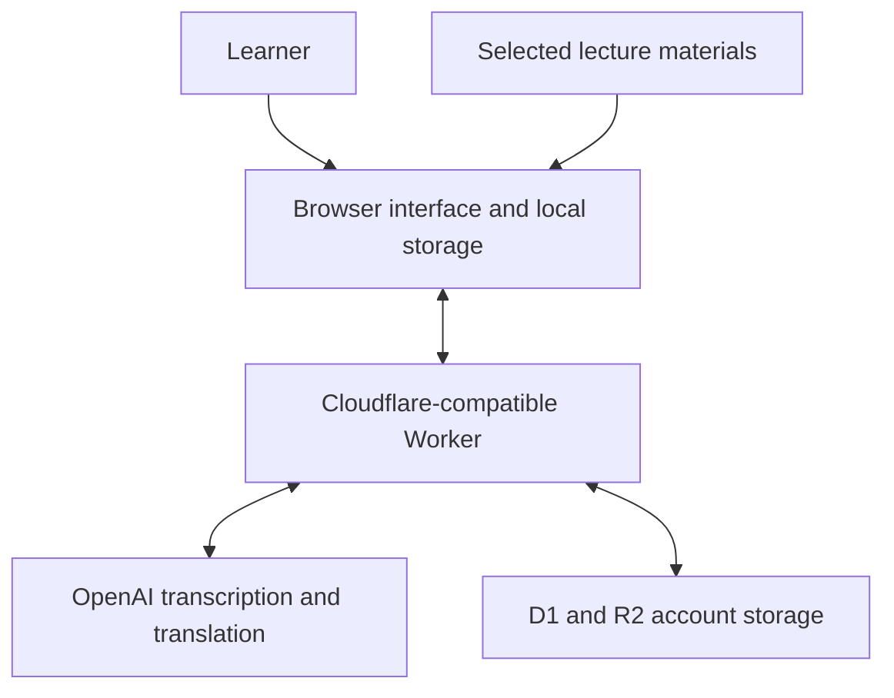

# Yuan Translate: Classroom Translation Assistant

English README prose word count: 957 (excluding code and link destinations).

Yuan Translate is an intelligent interactive system that helps students follow lectures in a second language. It brings speech transcription, Chinese translation, selected lecture materials and lesson notes into one interface. The project is developed for the University of Birmingham **Intelligent Interactive Systems** module.

- **Public demonstration:** [Open Yuan Translate](https://yuantranslate-classroom.noble-flute-7938.chatgpt.site/)
- **Assignment 2:** [Project status, development record and AI assistance](README_A2_reader_guide.md)
- **Detailed original documentation:** [Chinese README](README.zh-CN.md)

The public demonstration contains preset examples; it does not use a microphone or call an AI model. The application interface is currently in Chinese. The guide below translates the main controls and explains what a reader can inspect.

## Quick demonstration for reviewers

1. Open the [public site](https://yuantranslate-classroom.noble-flute-7938.chatgpt.site/).
2. Select **体验示例** (“Try an example”). The example opens without signing in.
3. Inspect the original-language segment, its Chinese translation and the sample lesson notes. These are demonstration data, not a live translation result.

| Chinese control | English meaning | Purpose |
| --- | --- | --- |
| 体验示例 | Try an example | Open the preset classroom demonstration |
| 开始上课 | Start class | Start recording when the service and permissions are available |
| 暂停 / 继续录音 | Pause / resume recording | Control audio capture |
| 结束录音 | End recording | Stop recording without automatically requesting a summary |
| 结束并总结 | End and summarise | Stop recording and request a summary when access permits |
| 实时字幕 · 桌面悬浮 | Live subtitles · floating window | Open the subtitle view on a supported desktop browser |
| 重新翻译 | Retry translation | Retry an eligible failed segment |
| 快速翻译 / 准确模式 | Fast / accurate mode | Select a transcription timing mode |

## What the system does

| Feature | Implemented behaviour and boundary |
| --- | --- |
| Bilingual lecture text | Presents the recognised source text alongside its Chinese translation. The translation may still be wrong. |
| Subject preferences | Lets a learner choose a discipline or enter a custom subject. The subject is supplied as context; it cannot verify the intended meaning. |
| Lecture materials | Imports PPTX, PDF, DOCX, TXT and Markdown. It extracts text and speaker notes where available; it does not visually interpret images or scanned slides. Older PPT/DOC files must be converted first. |
| Fast and accurate modes | Both use the same transcription model; fast mode uses shorter turn and merge waits. An accuracy or latency advantage has not been measured for this report. |
| Floating subtitles | Opens a desktop picture-in-picture window where the browser supports it; the window includes a control to return to the page. |
| Recovery and control | Provides recording controls and can show an error and retry option for eligible failed translations. |
| Review and export | Supports lesson history, notes and PDF, HTML or Markdown exports, subject to the relevant service and account settings. |

The earlier Week 3 two-entry glossary and term-clarification gate were a **manual simulation**. They are not presented as a working term-selection feature on the site.

## System overview



The browser captures audio, displays subtitles and handles selected documents. The Worker relays requests and, where configured, handles account and service access. The source configures `gpt-transcribe` for speech and `gpt-4.1-mini` for text generation. Guest data is kept locally in IndexedDB; authenticated lesson data can be saved through D1/R2. Audio and selected material text are sent to the relevant OpenAI service when live processing is used.

Material passages are selected using text overlap and bounded context. The translation prompt treats the supplied material and transcript as untrusted data and instructs the model not to add things that were not said. This is a design constraint, not a guarantee of correct or secure output. See [`src/models.js`](src/models.js), [`src/materials.js`](src/materials.js) and [`src/translation-prompt.js`](src/translation-prompt.js).

## Inspecting and testing the code

Node.js **22.22.1** was used for the selected checks described below. From the repository root:

```sh
npm ci
npm run build
npm test
```

The build produces browser assets and a Cloudflare-compatible Worker. Live speech and translation additionally depend on a configured server, service credentials, storage and appropriate account access. Configure secrets such as `OPENAI_API_KEY` on the server only; do not place them in the repository or browser. See the [detailed original documentation](README.zh-CN.md) for operational configuration.

On 25 November 2026, Codex ran **32 selected cases** from six existing test files against a hash-verified partial source copy of [commit `202e1a1`](https://github.com/gengyuan774/yuan-translate/commit/202e1a12f110c8aa48461a22a600832537a7db74); all 32 passed. They cover reference selection, recording completion, microphone handling, recovery, classroom navigation and save feedback. These isolated checks use simulated inputs and do not establish live classroom translation accuracy. The 20 November test report records 342 passing tests; the complete suite was not rerun for this assignment report. The exact selected-test command is in the [Assignment 2 reader guide](README_A2_reader_guide.md#development-and-checks).

## Code and evidence map

| Path | What to inspect |
| --- | --- |
| [`src/app.js`](src/app.js) | Browser interaction, controls and feedback |
| [`src/majors.js`](src/majors.js) | Subject choices and terminology instructions |
| [`src/material-parser.js`](src/material-parser.js) | Extraction of text from uploaded materials |
| [`src/models.js`](src/models.js) | Speech model and fast/accurate timing settings |
| [`src/subtitle-float.js`](src/subtitle-float.js) | Desktop floating subtitle window |
| [`src/worker.js`](src/worker.js) | Server routes, access checks and relays |
| [`test/`](test/) | Automated test cases and fixtures |
| [`docs/`](docs/) | Earlier dated software test report |

## Development and AI assistance

The student identifies subject options, PPTX upload, fast/accurate modes and floating subtitles as areas of contribution. The student reports using **ChatGPT, Claude and Gemini** during development. Codex drafted the assignment report, diagrams and reader guide, compared claims against the repository and demonstration, and ran the selected checks. The [Assignment 2 reader guide](README_A2_reader_guide.md) links relevant commits and gives more detail about the checks and development record.

## Limitations

- The public example is preset data and is not an end-to-end live-service test.
- No classroom user study or measured improvement in comprehension, cognitive load or translation accuracy is claimed.
- Model services, microphone permissions, account access and browser picture-in-picture support are dependencies.
- Imported images and scanned documents are not visually interpreted.
- Online payment is implemented as an adapter but remains dependent on merchant configuration and real-world acceptance; the existing documentation describes it as disabled until those steps are complete.
